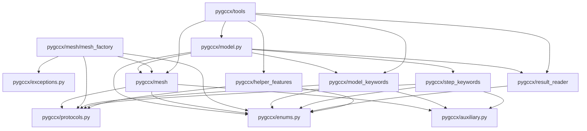
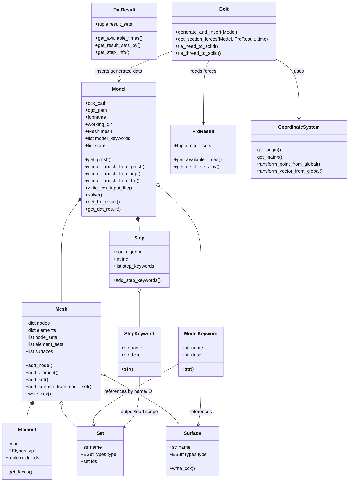

# Pygccx relational map

This map describes the principal objects, packages, files, and data flowing
through Pygccx. Source links are relative to the repository root.

## System flow

```mermaid
flowchart LR
    User[User / example script]
    Model[Model<br/>pygccx/model.py]
    Gmsh[Gmsh API]
    Inp[CalculiX .inp]
    FrdMesh[CGX / CalculiX .frd mesh]
    Mesh[Mesh<br/>nodes, elements, sets, surfaces]
    MK[Model keywords]
    Step[Step]
    SK[Step keywords]
    Input[jobname.inp]
    CCX[CalculiX ccx]
    FRD[jobname.frd]
    DAT[jobname.dat]
    FrdResult[FrdResult]
    DatResult[DatResult]
    Tools[Stress tools / Bolt / coordinate systems]
    Analysis[NumPy analysis / plots / reports]

    User --> Model
    Model --> Gmsh
    Gmsh -->|mesh_from_gmsh| Mesh
    Inp -->|mesh_from_inp| Mesh
    FrdMesh -->|mesh_from_frd| Mesh
    Model -->|owns/replaces| Mesh
    User --> MK
    User --> Step
    Step --> SK
    Model -->|add_model_keywords| MK
    Model -->|add_steps| Step
    Mesh -->|write_ccx| Input
    MK -->|str()| Input
    Step -->|str() + *END STEP| Input
    Input --> CCX
    CCX --> FRD
    CCX --> DAT
    FRD -->|FrdResult.from_file| FrdResult
    DAT -->|DatResult.from_file| DatResult
    FrdResult --> Tools
    DatResult --> Tools
    Mesh --> Tools
    Tools --> Analysis
    FrdResult --> Analysis
    DatResult --> Analysis
```

## Package dependency map



## Object relationship map



## Relationship details

| From | To | Relationship | Why it matters |
| --- | --- | --- | --- |
| `Model` | `Mesh` | owns one current mesh | Every mesh import replaces this object |
| `Mesh` | `Element` | stores elements by ID | Elements point back to node IDs and provide face topology |
| `Mesh` | `Set` | stores node and element sets | Keyword objects use sets to scope sections, loads, constraints, and output |
| `Mesh` | `Surface` | stores named interfaces | Contact, coupling, tie, and pretension keywords reference surfaces |
| `Model` | model keywords | ordered collection | Serialized after the mesh and before steps |
| `Model` | `Step` | ordered collection | Each step becomes `*STEP ... *END STEP` |
| `Step` | step keywords | ordered collection | Analysis, loads, and output are emitted in insertion order |
| mesh factories | `Mesh` | adapter boundary | External Gmsh/INP/FRD representations become the common internal graph |
| keyword objects | `enums.py` | constrained vocabulary | Enums keep CalculiX types and output names consistent |
| keyword objects | `protocols.py` | structural contracts | Keywords can consume compatible set/surface objects without tight imports |
| `Model` | `ccx` / `cgx` | subprocess boundary | The library writes files and invokes external programs |
| result readers | `.frd` / `.dat` | parser boundary | Solver output becomes queryable result sets |
| result sets | NumPy | numerical boundary | Values are exposed as arrays for calculations |
| `CoordinateSystem` | orientation/transform keywords | shared coordinate semantics | The same coordinate definition can drive input and post-processing |
| `Bolt` | `Model`, `Mesh`, keywords, `FrdResult` | composite feature | It generates a submodel, integrates it, and computes section forces |

## Serialization order

`Model.write_ccx_input_file()` follows this exact high-level order:

```text
1. Mesh.write_ccx()
   1a. nodes
   1b. elements grouped by element type
   1c. node sets and element sets
   1d. surfaces
2. model_keywords, in insertion order
3. steps, in insertion order
   3a. Step header
   3b. step_keywords, in insertion order
   3c. *END STEP
```

This ordering is the key coupling between otherwise independent packages.
Changing a keyword class usually changes only its own `__str__()` output, but
changing `Model`, `Mesh.write_ccx()`, or insertion order can affect the whole
input file.

## External file relationships

```text
Gmsh geometry + physical groups
    -> mesh_from_gmsh()
    -> Mesh nodes/elements/node_sets/element_sets

Existing CalculiX .inp
    -> mesh_from_inp()
    -> Mesh plus surfaces

Model + Mesh + keywords + steps
    -> write_ccx_input_file()
    -> jobname.inp
    -> ccx -i jobname
    -> jobname.frd and jobname.dat

jobname.frd
    -> FrdResult.from_file()
    -> FrdResultSet values keyed by node ID

jobname.dat
    -> DatResult.from_file()
    -> DatResultSet values keyed by node/element ID
       plus buckling/frequency step information
```

## Recommended trace paths

- **Input generation:** `Model.write_ccx_input_file()` ->
  `Mesh.write_ccx()` / keyword `__str__()` methods.
- **Gmsh conversion:** `Model.update_mesh_from_gmsh()` ->
  `mesh_factory.gmsh_factory.mesh_from_gmsh()`.
- **Imported INP behavior:** `Model.update_mesh_from_inp()` ->
  `mesh_factory.inp_factory.mesh_from_inp()` ->
  `_parse_content()`.
- **FRD post-processing:** `Model.get_frd_result()` ->
  `FrdResult.from_file()` -> `FrdResultSet.get_values_by_ids()`.
- **DAT post-processing:** `Model.get_dat_result()` ->
  `DatResult.from_file()` -> `DatResultSet.get_values_by_ids()`.
- **Bolt workflow:** `Bolt.generate_and_insert()` ->
  generated mesh/sets/surfaces/keywords -> `Model`; later
  `Bolt.get_section_forces()` consumes `FrdResult`.
